<h1 align="center">
	
	  
		YTDLnis
</h1>

	Azərbaycanca
	
	<a href="https://github.com/deniscerri/ytdlnis/blob/main/README.md">English</a>
	&nbsp;&nbsp;| &nbsp;&nbsp;
	<a href="https://github.com/deniscerri/ytdlnis/blob/main/docs/README-sq.md">Shqip</a>
	&nbsp;&nbsp;| &nbsp;&nbsp;
	<a href="https://github.com/deniscerri/ytdlnis/blob/main/docs/README-tr.md">Türkçe</a>
	&nbsp;&nbsp;| &nbsp;&nbsp;
	<a href="https://github.com/deniscerri/ytdlnis/blob/main/docs/README-id.md">Indonesia</a>
	&nbsp;&nbsp;| &nbsp;&nbsp;
	<a href="https://github.com/deniscerri/ytdlnis/blob/main/docs/README-pt.md">Português</a>
	&nbsp;&nbsp;| &nbsp;&nbsp;
	<a href="https://github.com/deniscerri/ytdlnis/blob/main/docs/README-es.md">Español</a>
	&nbsp;&nbsp;| &nbsp;&nbsp;
	<a href="https://github.com/deniscerri/ytdlnis/blob/main/docs/README-ja.md">Japanese</a>
	&nbsp;&nbsp;| &nbsp;&nbsp;
	<a href="https://github.com/deniscerri/ytdlnis/blob/main/docs/README-zh_CN.md">简体中文</a>
	&nbsp;&nbsp;| &nbsp;&nbsp;
	<a href="https://github.com/deniscerri/ytdlnis/blob/main/docs/README-ro.md">Română</a>
	&nbsp;&nbsp;| &nbsp;&nbsp;
	<a href="https://github.com/deniscerri/ytdlnis/blob/main/docs/README-ar.md">العربية</a>
	&nbsp;&nbsp;| &nbsp;&nbsp;
	<a href="https://github.com/deniscerri/ytdlnis/blob/main/docs/README-ru.md">Русский</a>

<h3 align="center">
	YTDLnis Android 7.0 və daha yuxarı versiyalar üçün yt-dlp istifadə edən pulsuz və açıq mənbəli video/audio endirmə alətidir.
</h3>
<h4 align="center">
	Yaradıcısı: Denis Çerri
</h4>

 
 
 
 

### Yalnız yuxarıdakı keçidlər YTDLnis-in etibarlı mənbələridir. Digər hər şeyin mənimlə əlaqəsi yoxdur.

## 💡 Xüsusiyyətlər

### ⬇️ Endirmə
- [1000+ veb-saytdan](https://github.com/yt-dlp/yt-dlp/blob/master/supportedsites.md) audio, video endirin və ya xüsusi yt-dlp əmrləri icra edin
- Tətbiqə keçid paylaşın və birbaşa aşağı kartdan endirin, tətbiqi açmağa ehtiyac yoxdur
- Məlumatların yüklənməsini gözləmədən dərhal başlamaq üçün sürətli endirmə rejimi
- Pleylistlər və toplu endirmələr: hər bir elementi ayrı-ayrılıqda redaktə edin və ya hamısı üçün növü, formatı, yolu və fayl adı şablonunu toplu şəkildə redaktə edin, müəllifə, müddətə, başlığa və ya tarixə görə çeşidləyin
- Keçidlərin, pleylistlərin və ya axtarış sorğularının `.txt` faylını daxil edin və tətbiq onların hamısını emal etsin
- Növbəyə qoyun, tarix və saata görə planlaşdırın və eyni vaxtda bir neçə endirmə işlədin
- Sürüşdürmə jestləri ilə dayandırın / davam etdirin, uğursuz və ya ləğv edilmiş elementləri yenidən endirin
- Mənbələri izləyin: pleylistləri və kanalları izləyin və əlavə sinxronizasiya seçimi ilə yeni yüklənmələri avtomatik endirin
- Dublikat yoxlanışı, uğursuz məlumat əldəetmələri yadda saxlanılır ki, onları daha sonra yenidən cəhd edə biləsiniz
- Endirmə yolunuz xarici yaddaş provayderi olduqda bulud provayderlərinə (məsələn, Nextcloud) yükləmələr
- İşləyən hər bir endirmə üçün Android 16 canlı bildirişləri

### ✂️ Fayllarınızın redaktəsi
- Videoları məhdudiyyətsiz kəsimlərlə vaxt damğalarına və ya fəsillərə görə kəsin və istəyə görə kəsimləri bir faylda birləşdirin
- Birbaşa endirmə kartından videoları kəsin (crop)
- Elementləri fəsillərə görə ayrı fayllara bölün
- SponsorBlock segmentlərini fəsil kimi silin və ya işarələyin
- Altyazıları, metadveriləri, fəsilləri və miniatürləri daxil edin və ya başlıq və müəllifi redaktə edin
- Altyazıları videoya yandırın
- [lrclib.net](https://lrclib.net) saytından sinxronlaşdırılmış və ya adi sözləri axtarın, onların vaxtını nəzərdən keçirin və tənzimləyin, sonra onları daxil edin və ya `.lrc` olaraq saxlayın
- Geniş dəstəklənən formatlarda yenidən kodlaşdırmaq üçün uyğunluq rejimi
- Canlı önizləmə ilə fayl adı şablonları və ya pleylist, veb-sayt və ya endirmə növünə görə sadə alt qovluqlar

### 🧑‍💻 Təcrübəli istifadəçilər üçün
- yt-dlp, Python, pip, FFmpeg və digər daxil edilmiş alətlərin istifadəyə hazir olduğu bash ilə tam terminal
- Ehtiyat nüsxəsini çıxara və paylaşa biləcəyiniz sintaksis vurğulaması olan əmr şablonları
- Kukilər dəstəyi: daxili brauzer vasitəsilə daxil olun və şəxsi və ya premium məzmunu endirin
- Daxili BGUtils provayderi ilə və ya tətbiqin veb-görünüşündə (webview) YouTube PO tokenləri yaradın
- Məlumat əldə etmə ekstraktoru olaraq NewPipe və ya yt-dlp seçin
- Veb-sayt sorğuları üçün curl-cffi daxil edilmiş Python, əlavə olaraq JS işləmə mühitləri (QuickJS, Deno, NodeJS)
- Xüsusi yt-dlp mənbələri və avtomatik yt-dlp yeniləmələri
- Tasker kimi tətbiqlərlə avtomatlaşdırma üçünIntent-lər

### 🎨 Tətbiq
- Mövzu seçimləri və fərdiləşdirilə bilən aşağı naviqasiya ilə Material You dizaynı
- Heç bir tarixçənin və ya loqların saxlanılmadığı İnkoqnito rejimi
- Endirmə loqları, axtarış tarixçəsi və müxtəlif kart düzenlərinə malik ətraflı endirmə tarixçəsi
- Demək olar ki, hər şeyin ehtiyat nüsxəsini çıxarın və bərpa edin, həm də birbaşa qarşılama ekranından
- Keşləri və qalıqları təmizləmək üçün fayl meneceri

## 🧩 Plagin Dəstəyi

YTDLnis istifadəçilərə aşağıdakı kimi komponentləri sərbəst şəkildə təkmilləşdirməyə və aşağı salmağa imkan vermək üçün plaginləri idarə edir:
- Python
- JS İşləmə mühitləri (NodeJS, Deno)
- FFmpeg
- Aria2c

Siz ytdlnis paketlərini bu [ytdlnis-packages](https://github.com/deniscerri/ytdlnis-packages/) repozitoriyasından və ya tətbiqdaxili yeniləmə bölməsindən quraşdıra bilərsiniz.
 Ətraflı məlumat üçün repozitoriyanın README faylına baxın.

## 📲 Ekran görüntüləri

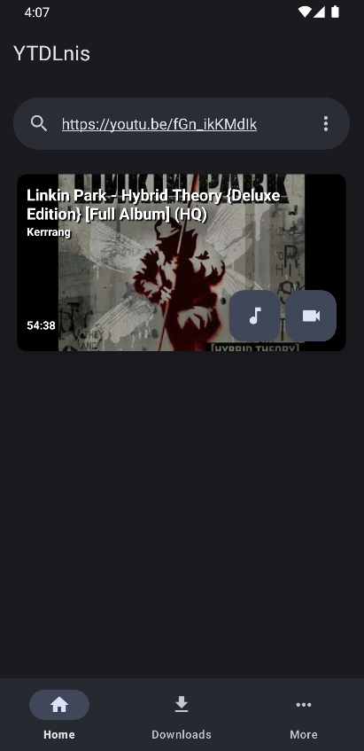
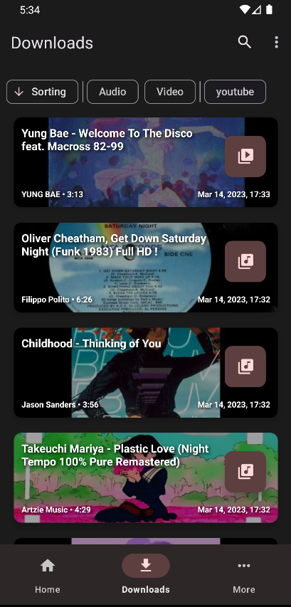
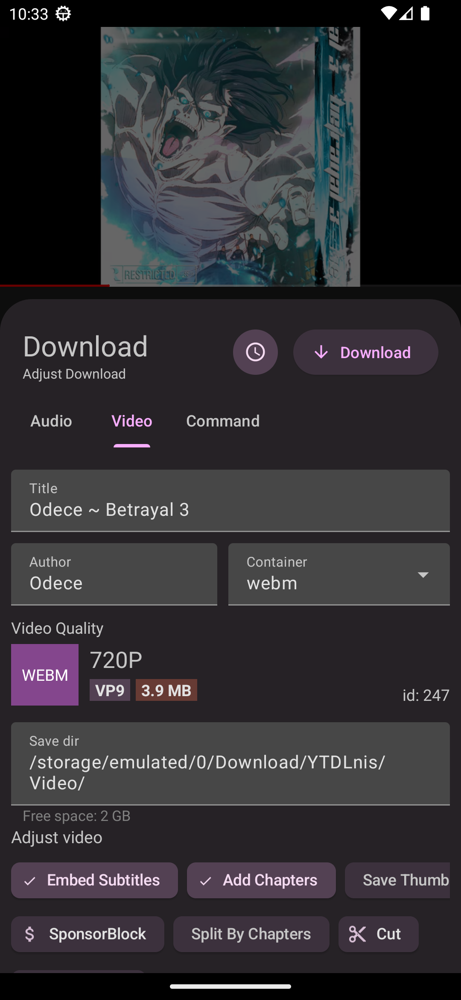
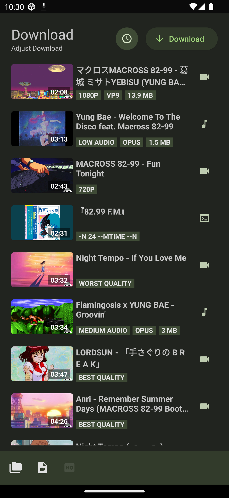
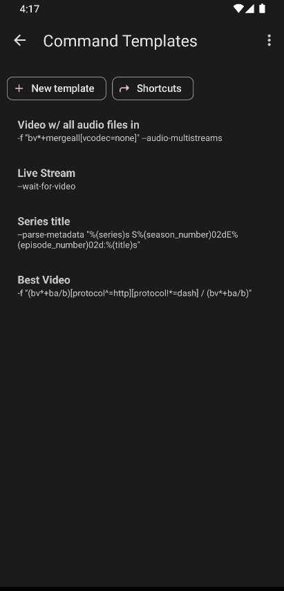
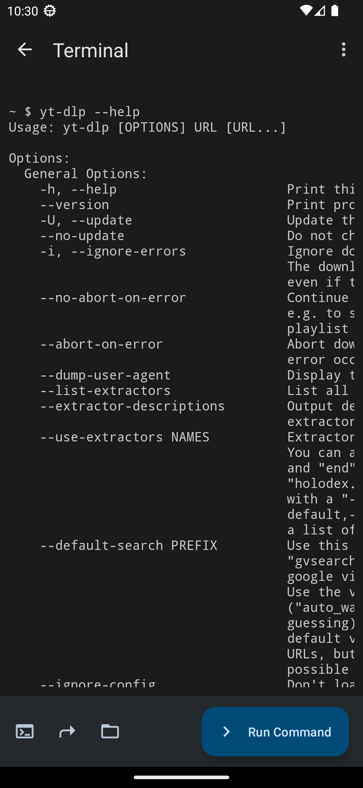
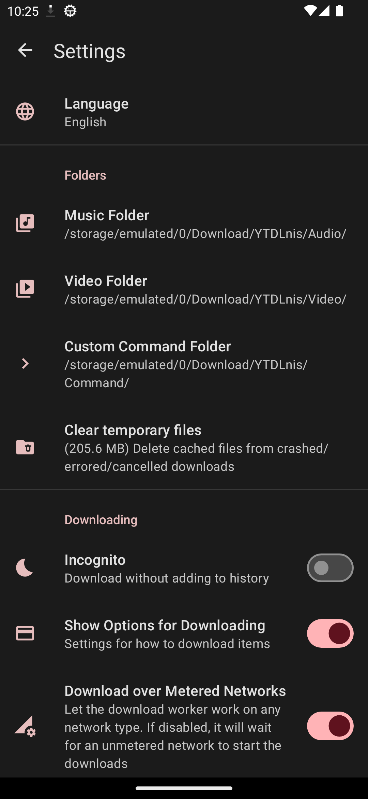
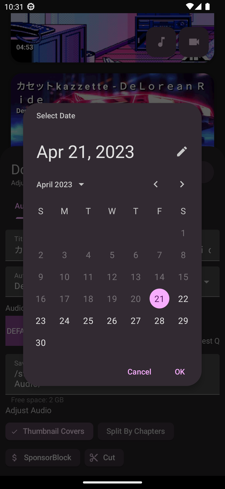
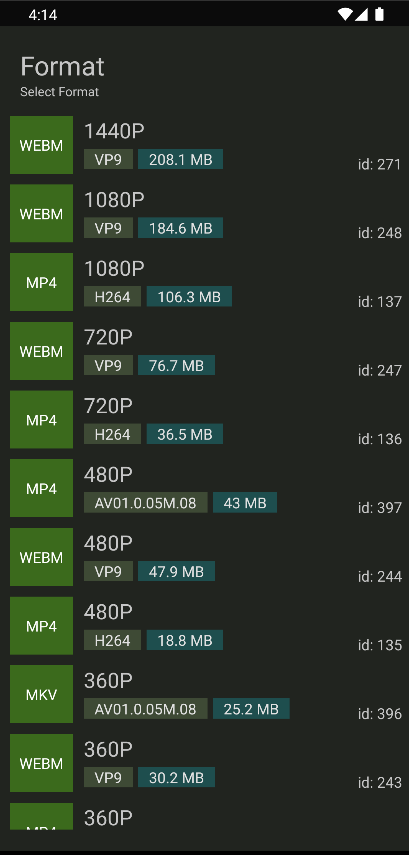
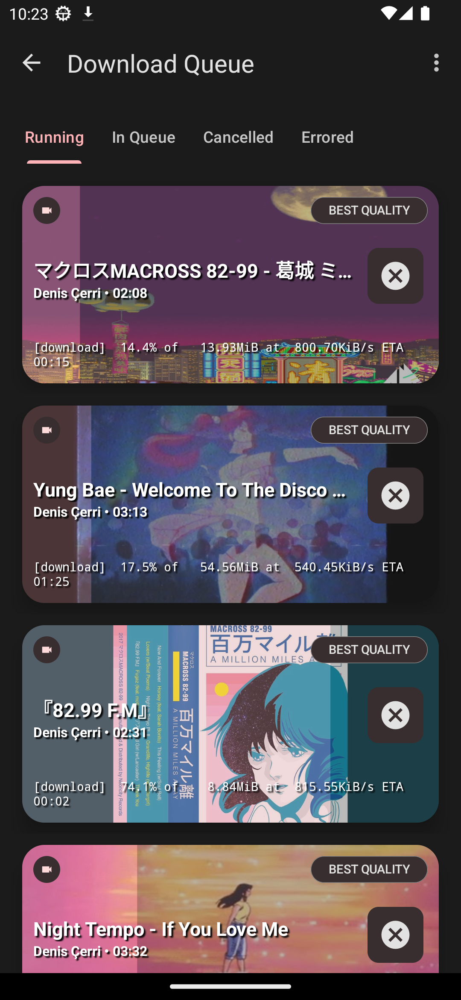
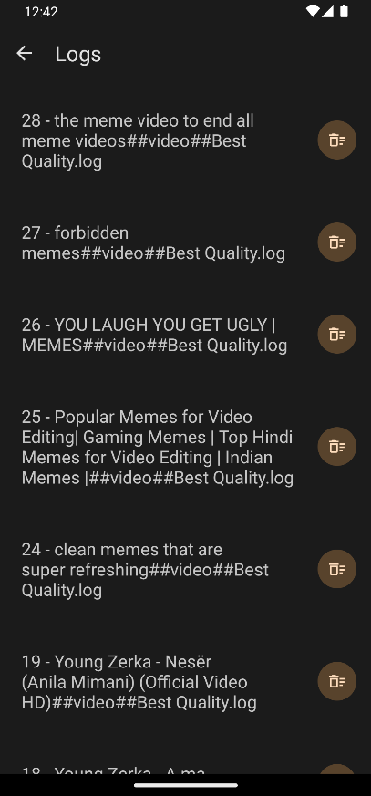
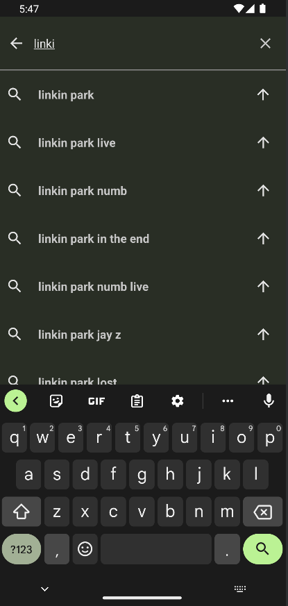
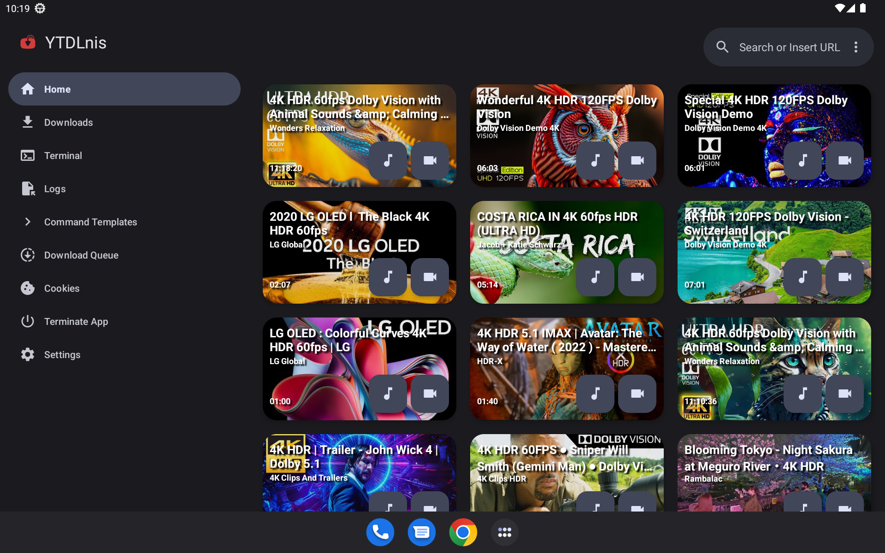

## 💬 Əlaqə

Elanlar, müzakirələr və buraxılışlar üçün [Discord](https://discord.gg/WW3KYWxAPm) və ya [Telegram kanalımıza](https://t.me/ytdlnis) qoşulun.

## 😇 Töhfə vermək

Əgər töhfə vermək istəyirsinizsə, lütfən [töhfə vermə](CONTRIBUTING.MD) bölməsini oxuyun.

## 📝 Weblate-də tərcümə etməyə kömək edin

## 🔑 Paket adı vasitəsilə üçüncü tərəf tətbiqləri ilə əlaqə qurun

Tətbiqin paket adı "com.deniscerri.ytdl"-dir.

## 🔍 Tətbiq imzasını yoxlayın

Tətbiq aşağıdakı imzanı ehtiva etməlidir. GitHub iş axını əmri (workflow action) bundan istifadə edir və buraxılışlar təkrarlana bilən (reproducible) quruluş yaratmaq üçün buna əsaslanır.
Əgər imza fərqlidirsə, üçüncü tərəf distribyutorunuz tətbiqi dəyişdirib. Lütfən, orijinal imzası olan tətbiqdən istifadə edin.

    Signer #1 certificate DN: CN=Denis Cerri, OU=Personal, O=Personal, L=Albania, ST=Albania, C=AL
    Signer #1 certificate SHA-256 digest: 263645cb5272eb290759fe1f59149ae24df6ce171e9f6666eead981d3fc64c95
    Signer #1 certificate SHA-1 digest: 2fec9c2fcef68d29a60857e185c795fec5f56fb6
    Signer #1 certificate MD5 digest: 429d0c6315d2f99650f66cc44cf5a794

## 🤖 Intent-lərdən istifadə edərək üçüncü tərəf tətbiqləri ilə əlaqə qurun

İstifadəçi müdaxiləsi olmadan endirmələri işə salmaq üçün tətbiqə əmrlər göndərmək məqsədilə Intent-lərdən istifadə edə bilərsiniz.
Qəbul edilən dəyişənlər:

<b>TYPE</b> -> ola bilər: audio, video, command  
<b>BACKGROUND</b> -> ola bilər: true, false. Əgər true olarsa, tətbiq heç bir halda endirmə kartını göstərməyəcək və endirməni arxa planda icra edəcək  

### Tasker ilə arxa planda audio elementinin endirilməsi nümunəsi
1. Send Intent tapşırığı yaradın
2. Action: android.intent.action.SEND
3. Cat: Default
4. Mime Type: text/*
5. Extra: android.intent.extra.TEXT:url ("url" əvəzinə endirmək istədiyiniz videonun URL ünvanını yazın)
6. Extra: TYPE:audio
7. Extra: BACKGROUND:true

## 📄 Lisenziya

[GNU GPL v3.0](https://github.com/deniscerri/ytdlnis/blob/main/LICENSE)

GPLv3 lisenziyası altında lisenziyalaşdırılmış mənbə kodu istisna olmaqla, digər bütün tərəflərə "YTDLnis" adını endirmə tətbiqi kimi istifadə etmək qadağandır və eyni qayda onun törəmələrinə də şamil edilir. Törəmələrə fork-lar və qeyri-rəsmi quruluşlar daxildir, lakin bunlar bununla məhdudlaşmır.

## 😁 İanə edin

## 🙏 Təşəkkürlər

- Tətbiqin ikonu üçün [decipher3114](https://github.com/decipher3114)-ə
- youtubedl-android-ün tətbiqinə nümunə olduğuna görə [dvd](https://github.com/yausername/dvd)-yə
- Bu tətbiqi hazırlamağa başlayanda malik olmaq istədiyim müəyyən dizayn elementləri və xüsusiyyətlərinə görə [seal](https://github.com/JunkFood02/Seal)-a
- yt-dlp-ni Android-ə port etdiyinə görə [youtubedl-android](https://github.com/yausername/youtubedl-android)-ə
- Bu aləti mümkün etdikləri üçün [yt-dlp](https://github.com/yt-dlp/yt-dlp) və onun töhfəvericilərinə

və töhfəvericilər kimi bir çox digər insanlara.
